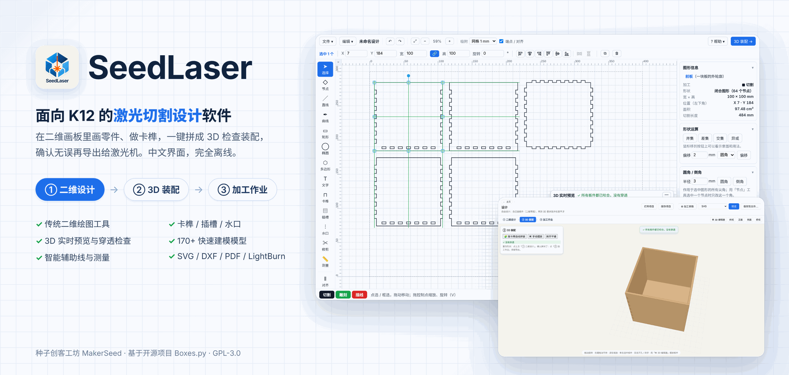
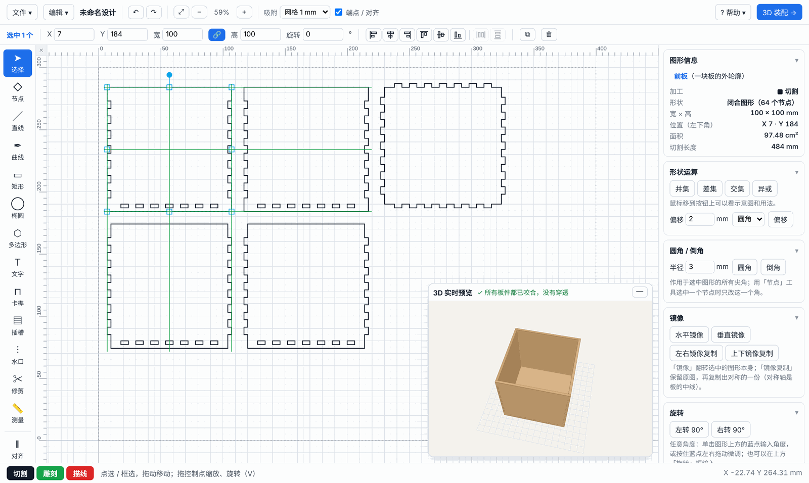
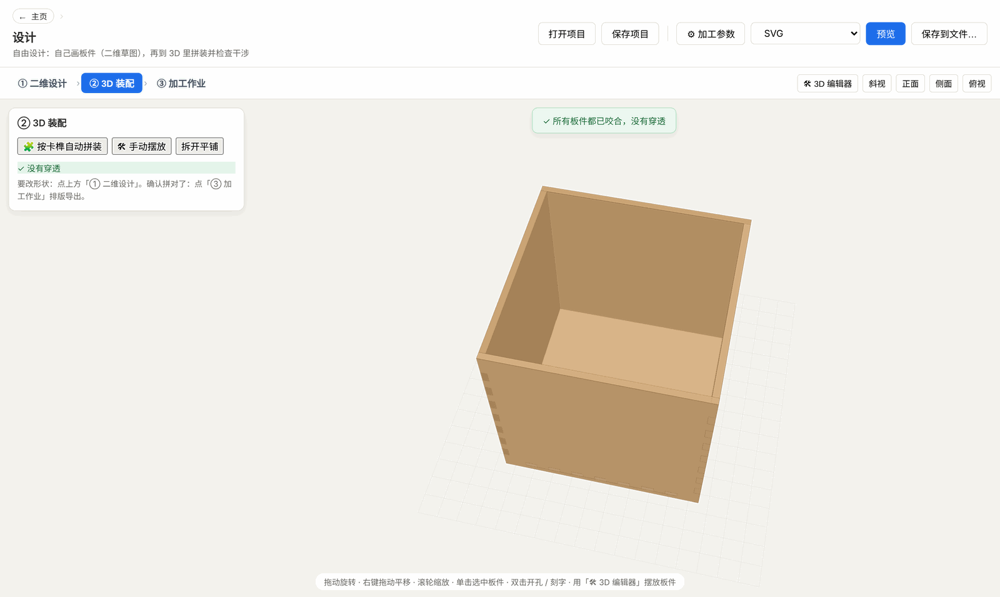
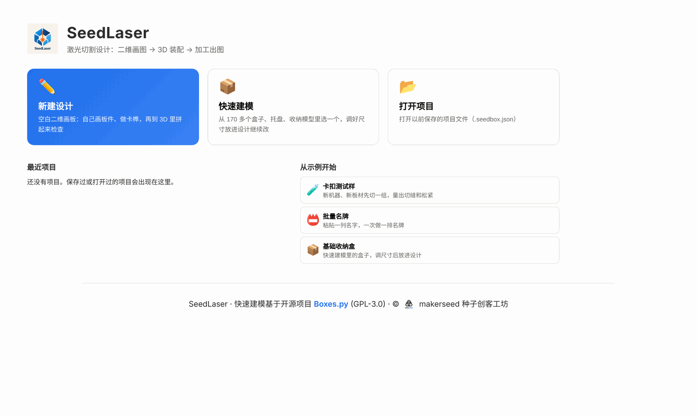
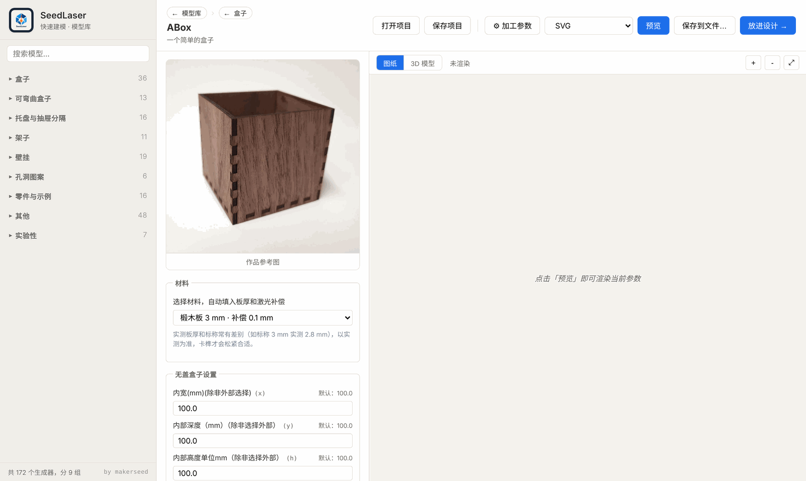
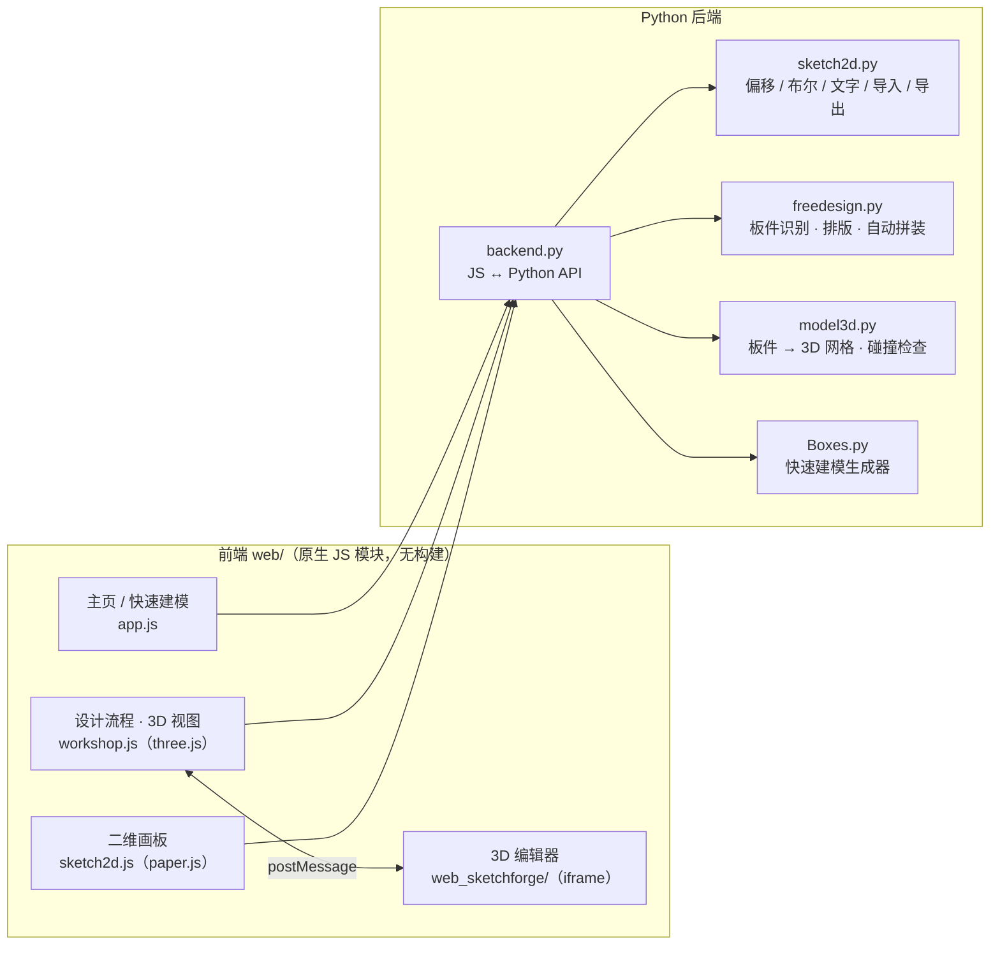

<h1 align="center">SeedLaser</h1>

<p align="center">
  面向 K12 的激光切割设计软件：<b>二维设计 → 3D 装配 → 加工作业</b><br/>
  中文界面 · 100% 离线 · Windows 单 exe / macOS .app
</p>

<p align="center">
  <a href="LICENSE"></a>
  
  
  <a href="https://github.com/makerseed201808/SeedLaser/releases/tag/v0.2.0"></a>
  <a href="CHANGELOG.md"></a>
</p>

<p align="center">
  
</p>

---

## 简介

SeedLaser 是 [种子创客工坊（MakerSeed）](https://github.com/makerseed) 为中小学创客课堂做的激光切割设计软件，原名 SeedBoxes。它的定位是：

1. **二维画板是学生的绘图工具**：保留直线、矩形、节点编辑、对齐、形状运算这些传统的二维基本操作，锻炼绘图基本功；软件只负责出图纸，不直接控制激光机。
2. **3D 用来检查，而不是用来建模**：二维画好的板件一键拼成 3D，在切割之前就看到「拼起来是什么样、哪里撞了、哪里没接上」，再回到二维里改。
3. **创新点在二维和三维之间**：板件怎么连接（卡榫、插槽）、位置对不对，是学生最容易出错的地方，也是 SeedLaser 重点解决的问题。

「快速建模」模型库来自开源项目 [Boxes.py](https://github.com/florianfesti/boxes)：170 多个盒子、托盘、收纳模型，调好尺寸就能「放进设计」继续改。

---

## 三个板块

### ① 二维设计

<p align="center"></p>

- **绘图工具**：直线、曲线（钢笔）、矩形、椭圆（⌘ 拖动画正圆）、多边形 / 星形、文字（中文字体、多行、圆弧、沿路径排列）、节点编辑、修剪、测量。
- **加工方式**：切割（黑色实线）、雕刻（绿色填充）、描线（红色实线）；左下角色块切换，导出时自动分层。
- **连接结构**：卡榫（指接 A / 指接 B / 凹槽）、插槽（T 字形连接）、水口（微连，零件切完不掉）；齿深和板厚联动，板厚变化时提醒并一键重做。
- **精确操作**：上下文栏输入位置 / 宽高 / 角度；绿色智能辅助线（对齐、居中、贴边、相切自动吸附）；标尺和参考线；单击旋转点输入角度，左右拖动微调。
- **编辑命令**：形状运算（并集、差集「刀」、交集、异或）、偏移、圆角 / 倒角、镜像 / 镜像复制、阵列（直线 / 环形 / 沿路径 / 矩形）、编组。
- **顺手的交互**：右侧属性面板跟着选中内容变化，「图形信息」卡片显示所属板件、尺寸、面积、切割长度；右键圆形快捷菜单（可自定义）；完整快捷键（帮助 → 快捷键一览）。
- **自动识别板件**：所有板件画在一张材料上，闭合的切割轮廓自动识别为板，里面的图形就是孔、雕刻和描线。
- **3D 实时预览**：右下角随画随更新，红色 = 板和板之间穿透。

### ② 3D 装配

<p align="center"></p>

- **按卡榫自动拼装**：跨板配对的卡榫会把板自动拼起来，拼好后检查穿透和咬合。
- **手动摆放**：内嵌 3D 编辑器（基于 SketchForge-3D），移动、旋转、对齐、落到台面。
- **位置互相独立**：3D 里摆放的装配位置不会改动二维画板上的排版；回到二维修改后再进 3D，装配位置还在。

### ③ 加工作业

- 板件数量、哪些要切，只在这里设置。
- 导出 **SVG / LightBurn（lbrn2）**；安装 pstoedit / Ghostscript 后还可以导出 **DXF / PDF / GCode / PLT**。
- 加工参数（速度、功率、遍数）随图纸写出一份说明。
- **卡榫测试样**：新机器、新材料先切一组，填入卡尺读数，自动算出切缝补偿和插槽间隙。

### 主页与快速建模

<p align="center">
  
  
</p>

- **主页**：新建设计 / 快速建模 / 打开项目三个入口，最近项目和示例（卡榫测试样、批量名牌、基础收纳盒）。
- **快速建模**：Boxes.py 的 170 多个生成器，中文界面和作品参考图；「放进设计 →」把板件连同装配位置放进二维画板。
- **多开项目**：顶部标签栏像 Fusion 一样同时开多个项目，点标签切换，⌂ 回主页，＋ 新建。
- **文件**：二维画板左上角「文件」菜单：新建、打开、最近打开、保存（⌘S）、另存为（⇧⌘S）、导入 SVG / DXF / 图片描摹（⌘I）、导出图纸。项目文件扩展名为 `.seedbox.json`。

---

## 快速开始（开发模式）

依赖 [uv](https://docs.astral.sh/uv/)（Python 包管理器）。

```bash
git clone https://github.com/makerseed201808/SeedLaser.git
cd SeedLaser
./run_mac.sh          # macOS（也可以在 Finder 里双击 run_mac.command）
```

Windows：

```cmd
run_uv.bat
```

首次运行会自动 `uv sync` 安装依赖（包含从 GitHub 拉取 Boxes.py release-1.2），并运行 `scripts/fetch_boxes_assets.py` 下载上游作品照片和翻译到 `boxes_assets/`（约 30 MB），需要 2~3 分钟。之后启动很快，可以完全离线使用。

> 连不上 GitHub？在能访问 GitHub 的电脑上运行 `scripts/make_boxes_mirror.sh`，把整个文件夹（含 `third_party/`）拷过去，`run_mac.sh` 会自动改用本地镜像。

**浏览器调试**：`uv run python scripts/dev_server.py`，然后打开 `http://127.0.0.1:8765/index.html?dev=1`。前端通过 `web/dev-bridge.js` 用 HTTP 调用同一套后端 API（文件对话框在这个模式下不可用）。

---

## 打包发布

| 平台 | 命令 | 产物 |
|---|---|---|
| Windows | `build_uv.bat` | `dist\SeedLaser.exe`（单文件，约 100 MB，依赖系统自带的 WebView2） |
| macOS | `./build_mac.sh` | `dist/SeedLaser.app` 和分发用的 `dist/SeedLaser-macOS.zip` |

macOS 只能在 Mac 上打包，产物架构和打包机一致（Apple 芯片打出的是 arm64）。未签名的 .app 第一次打开会被拦截：右键 → 打开，或在「系统设置 → 隐私与安全性」里点「仍要打开」。

### 启用 DXF / PDF / GCode 输出

默认可以输出 SVG / PS / LBRN2。要输出 DXF / GCode / PLT / PDF，需要装两个命令行工具，装好后重启软件，格式下拉框会自动出现新选项：

```bash
brew install pstoedit ghostscript                    # macOS
```

```cmd
winget install --id=Cybernetic.pstoedit             :: Windows：DXF / GCode / PLT
winget install --id=ArtifexSoftware.GhostScript     :: Windows：PDF（含 ps2pdf）
```

---

## 架构



- **桌面外壳**：PyWebView（Windows 用 WebView2，macOS 用 WKWebView）；前端通过 `window.pywebview.api.<方法>()` 直接调用 Python，不走 HTTP。
- **前端**：原生 HTML / CSS / ES 模块，不需要构建工具；二维画板用 paper.js，3D 用 three.js（都在 `web/vendor/`）。
- **几何计算**在 Python 端：偏移、布尔运算、实体判定（交叉的切割轮廓按实体合并，完全在里面的才是孔）用 shapely；文字轮廓用 fonttools 读取系统字体。
- **项目数据**：`.seedbox.json` 里保存每块板的二维草图（y 向上，单位 mm）、板件排版、3D 装配姿态和加工参数。二维排版位置和 3D 装配位置互相独立。
- **快速建模**：不修改上游 Boxes.py 源码，通过 git 引用 `release-1.2`，所有定制都在客户端层。

更详细的约定（数据格式、坐标系、配对规则、测试要求）见 [CLAUDE.md](CLAUDE.md) 和 [docs/ROADMAP.md](docs/ROADMAP.md)。

---

## 项目结构

```
SeedLaser/
├── app.py                     PyWebView 入口（窗口、启动）
├── backend.py                 JS ↔ Python API：生成器、渲染导出、项目文件、最近项目、i18n
├── sketch2d.py                二维几何：偏移、布尔、实体判定、文字排版、SVG/DXF 导入、描摹
├── freedesign.py              自由设计：板件识别、排版、按卡榫自动拼装
├── model3d.py                 板件 → 3D 网格、干涉 / 咬合检查、字体
├── web/                       前端
│   ├── index.html / styles.css
│   ├── app.js                 主页、快速建模、文件（打开 / 保存 / 导出 / 最近项目）
│   ├── workshop.js            设计三板块、3D 视图与装配、二维画板 ↔ 项目数据
│   ├── sketch2d.js            二维画板（工具、属性面板、辅助线、测量、文件菜单…）
│   ├── sketch-import.js       DXF 解析、图片二值化（描摹）
│   ├── fit-calc.js            卡榫测试样的换算
│   ├── dev-bridge.js          浏览器调试时模拟 pywebview
│   └── vendor/                paper.js、three.js
├── web_sketchforge/           内嵌 3D 编辑器（SketchForge-3D 构建产物，AGPL-3.0）
├── sketchforge/               SketchForge 改版补丁和构建脚本
├── tests/
│   ├── e2e/                   浏览器端到端测试（Playwright，run.sh 全部运行）
│   ├── js/  py/               单元测试
├── scripts/
│   ├── dev_server.py          浏览器调试服务器
│   ├── fetch_boxes_assets.py  下载上游作品照片和翻译
│   ├── make_boxes_mirror.sh   离线镜像
│   ├── push_github.command    手动推送到 GitHub（分支 + 版本标签）
│   └── setup_autopush.command 安装 Mac 后台自动推送
├── docs/                      ROADMAP、截图
├── pyproject.toml / uv.lock   依赖（boxes 通过 git 引用 release-1.2）
├── SeedLaser.spec             PyInstaller 打包配置
├── run_mac.sh / run_mac.command / build_mac.sh    macOS 运行 / 打包
├── run_uv.bat / build_uv.bat                      Windows 运行 / 打包
├── build_pyd.bat / setup_ext.py / install_msvc.bat 可选：backend.py 编译为 .pyd
├── CHANGELOG.md / CLAUDE.md / DEVELOPMENT.md      更新日志、开发约定、开发历程
└── LICENSE                    GPL-3.0
```

---

## 测试

```bash
uv run python scripts/dev_server.py &      # 先启动调试服务器
tests/e2e/run.sh                           # 全部端到端测试（也可以 run.sh file1 bar1 只跑几个）
node tests/js/fit_calc.test.mjs            # 卡榫测试样换算
uv run python tests/py/test_recent.py      # 最近项目 / 打开旧项目
```

端到端测试都带断言，覆盖画板的主要操作（画图、选择移动、旋转、形状运算、测量、文件菜单、菜单栏……）和设计流程（快速建模放进设计、3D 装配无穿透、卡榫测试样换算）。每次改动后全部跑一遍。

---

## 版本管理

- 版本号：`主版本.次版本.修订`，在 `pyproject.toml` 和 `app.py` 窗口标题里；每个版本在 [CHANGELOG.md](CHANGELOG.md) 写一节，并打标签 `vX.Y.Z`。
- 推送：在 Mac 上运行一次 `scripts/setup_autopush.command`，之后有新提交或新标签会在后台自动推到 GitHub 并弹通知；也可以随时双击 `scripts/push_github.command` 手动推送。
- 本地开发分支推到 GitHub 的 `main`。

---

## 可选：保护后端代码

`backend.py` 可以用 Cython 编译为 `.pyd`（目前脚本只支持 Windows）：

```cmd
install_msvc.bat        :: 一次性安装 MSVC Build Tools（约 4 GB）
build_pyd.bat           :: backend.py → backend.cp310-win_amd64.pyd
build_uv.bat            :: 重新打包，自动用 .pyd 代替 .py
```

---

## 许可

本项目采用 **GPL-3.0-or-later**，与上游 Boxes.py 一致。如分发本程序，需要附带源码或源码获取方式。

| 组件 | 许可 | 用途 |
|---|---|---|
| [Boxes.py](https://github.com/florianfesti/boxes)（Florian Festi） | GPL-3.0 | 快速建模生成器 |
| [SketchForge-3D](https://github.com/Formsmith746/SketchForge-3D) | AGPL-3.0 | 内嵌 3D 编辑器（`web_sketchforge/`，改动见 `sketchforge/seedboxes.patch`） |
| [pywebview](https://github.com/r0x0r/pywebview) | BSD-3-Clause | 桌面外壳 |
| [paper.js](http://paperjs.org) | MIT | 二维画板 |
| [three.js](https://threejs.org) | MIT | 3D 视图 |
| [shapely](https://github.com/shapely/shapely) / [fonttools](https://github.com/fonttools/fonttools) | BSD-3 / MIT | 几何计算 / 字体轮廓 |

---

## 致谢

- [Florian Festi](https://github.com/florianfesti)：Boxes.py 原作者
- 上游 zh_CN 翻译贡献者：裘炯涛 \<qiujiongtao@163.com\>
- SketchForge-3D 作者

© makerseed 种子创客工坊
